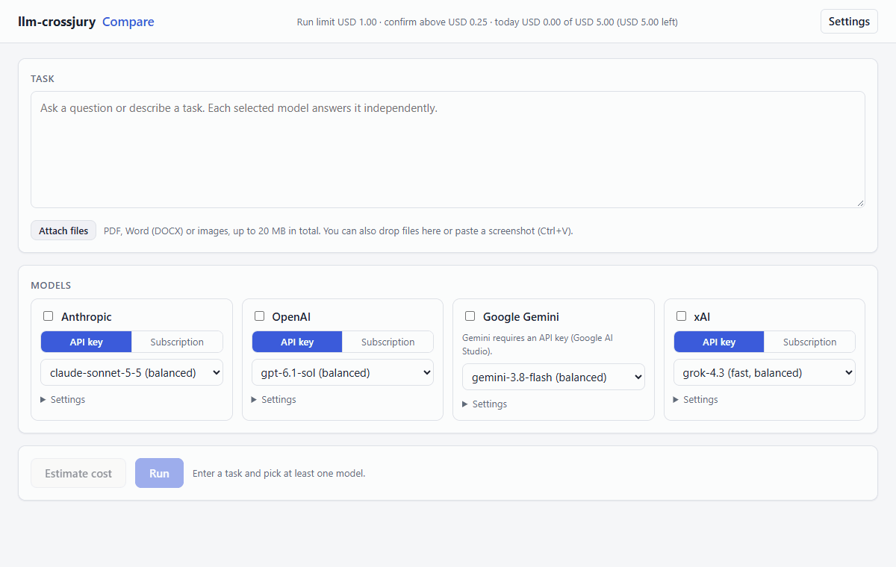
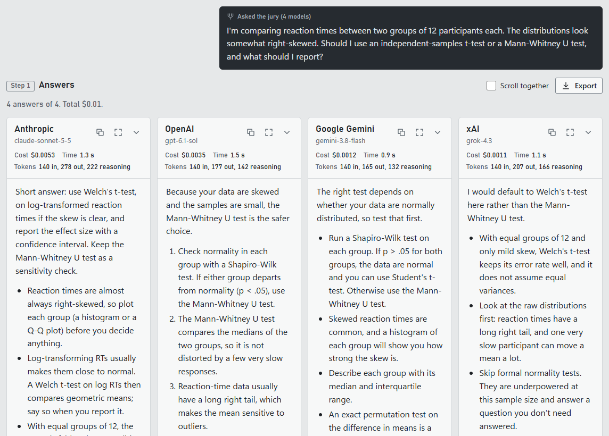
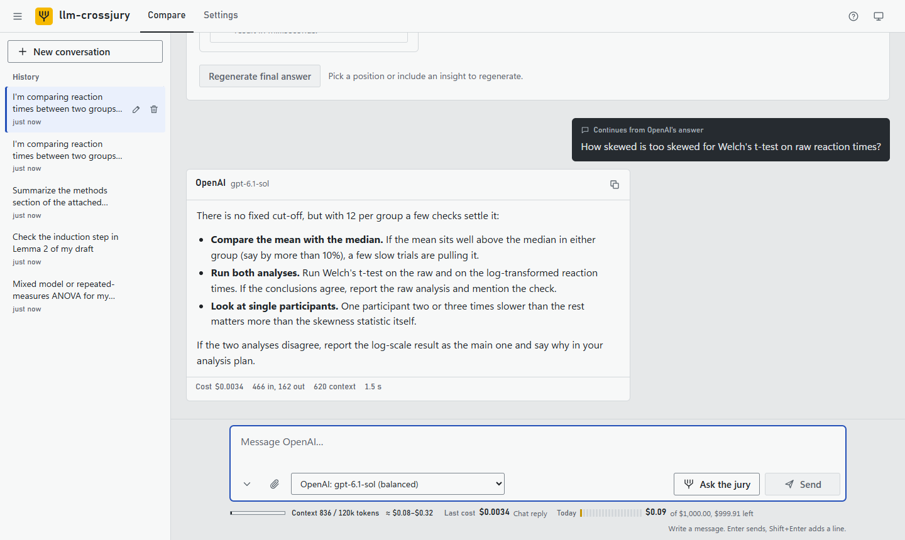
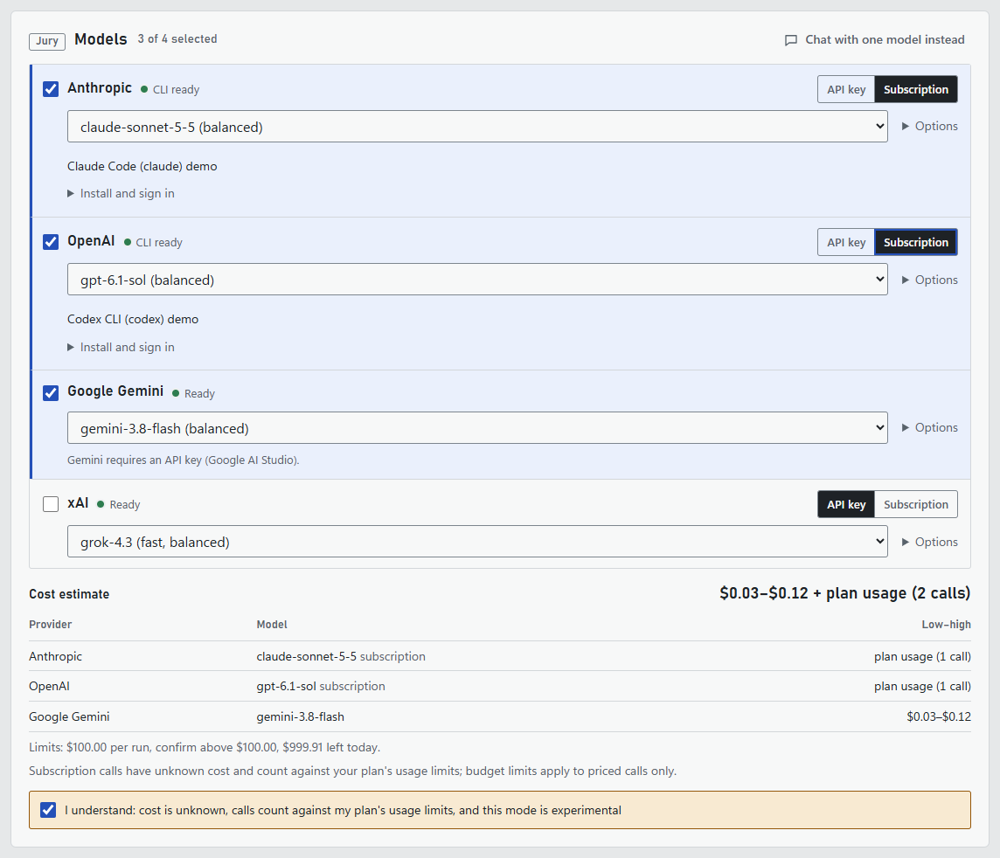
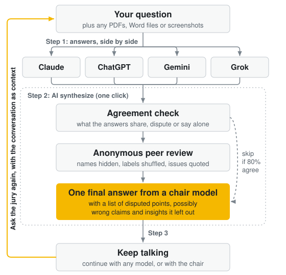
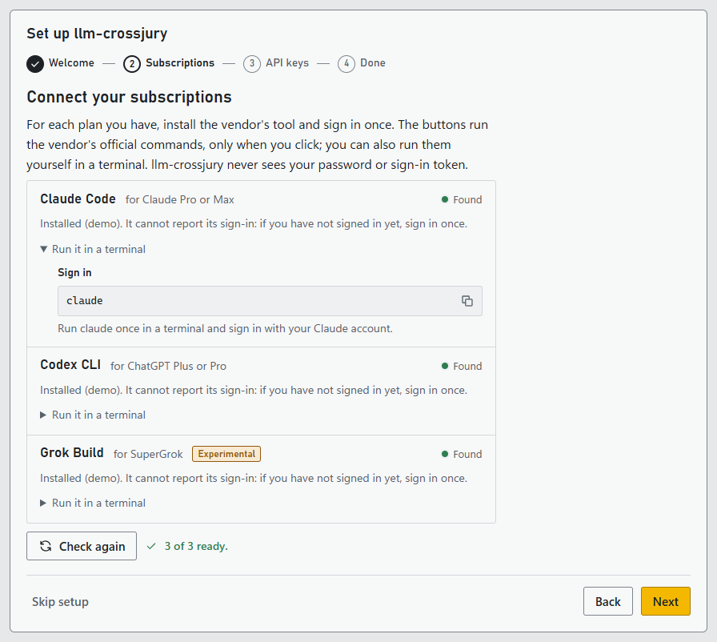

<p align="center">
  <picture>
    <source media="(prefers-color-scheme: dark)" srcset="docs/assets/logo-dark.svg">
    
  </picture>
</p>

<p align="center">
  <strong>Ask several AI models the same question, see their answers side by side, and
  get one final answer that lists what they still disagree on.</strong>
</p>

<p align="center">
  <a href="LICENSE"></a>
  
  
  
  <!-- When the repository is public, add the CI badge:
  <a href="https://github.com/andyl929/llm-crossjury/actions/workflows/ci.yml"></a>
  and, after the first PyPI release, a PyPI version badge. -->
</p>

<p align="center">
  <a href="#quick-start">Quick start</a> &nbsp;·&nbsp;
  <a href="#how-it-works">How it works</a> &nbsp;·&nbsp;
  <a href="#api-keys-or-subscriptions">Keys or subscriptions</a> &nbsp;·&nbsp;
  <a href="#privacy-and-cost">Privacy and cost</a> &nbsp;·&nbsp;
  <a href="#faq">FAQ</a>
</p>

<p align="center">
  
</p>

llm-crossjury is a local app for students, researchers and developers who want a second
opinion on an AI answer, and a third and a fourth. It sends your question, and any PDFs,
Word files or screenshots, to models from Anthropic, OpenAI, Google and xAI, and shows the
answers next to each other. One click then has the models review each other anonymously
and a chair model write one final answer, with the points still in dispute listed for you
to decide. After that you keep talking with any model, and can hand the next question back
to the whole jury.

It runs on your computer with your own API keys or the Claude, ChatGPT or SuperGrok
subscription you already have, and it shows the cost before every run.

## Why

- **One model can be confidently wrong.** With several independent answers you see what
  they agree on, where they contradict each other, and which claims other models flag as
  wrong, with the passage quoted.
- **Comparing tabs by hand is slow.** One question goes to up to four models at once, the
  answers line up in columns, and the comparison is written down instead of kept in your
  head.
- **Multi-model costs add up.** Every run is estimated before it starts, budgets stop runs
  that would go over, and subscription calls are labelled as plan usage.

## What you can do

| Job | How |
|---|---|
| **Check an answer against other models** | Pick up to four models and ask once. Each answers on its own; the answers appear side by side with cost, time and tokens. Run one model again without rerunning the others. |
| **Get one answer you can trust more** | **AI synthesize** measures agreement, runs one round of anonymous peer review and has a chair model write the final answer. The additional list shows disputed points (marked "Decided by AI"), insights left out and possibly wrong claims. Overrule a decision and regenerate. |
| **Keep working on it** | **Continue with** any model, or with the chair, as a normal chat. Ask the jury again at any point: every juror gets the conversation so far as context. |
| **Work from your files** | Attach PDFs, Word files and images, or paste a screenshot. Models that read PDFs and images get the original; the others get the extracted text. Before you run, you see which vendors will receive the files. |
| **Come back later** | Conversations are saved on your computer and listed in the sidebar. Close the tab mid-run and the result is there when you return. Export any conversation as Markdown. |
| **Use what you already pay for** | Run Claude Code, Codex CLI or Grok Build (experimental) on your subscription instead of an API key. The setup wizard installs and signs in to each with one click. |

<table>
<tr>
<td width="50%" valign="top">

<strong>Answers side by side</strong>

<picture>
  <source media="(prefers-color-scheme: dark)" srcset="docs/assets/answers-dark.png">
  
</picture>

</td>
<td width="50%" valign="top">

<strong>The additional list</strong>

<picture>
  <source media="(prefers-color-scheme: dark)" srcset="docs/assets/additional-list-dark.png">
  
</picture>

</td>
</tr>
<tr>
<td valign="top">

<strong>Continue with one model</strong>

<picture>
  <source media="(prefers-color-scheme: dark)" srcset="docs/assets/conversation-dark.png">
  
</picture>

</td>
<td valign="top">

<strong>Subscriptions and the cost estimate</strong>

<picture>
  <source media="(prefers-color-scheme: dark)" srcset="docs/assets/models-dark.png">
  
</picture>

</td>
</tr>
</table>

More: [the final answer](docs/assets/synthesis-light.png) and
[attachments in the composer](docs/assets/attachments-light.png). All screenshots and the
animation come from demo mode, so the models, answers, costs and budget limits in them are
simulated. They are regenerated with
[`scripts/capture_readme_media.py`](scripts/capture_readme_media.py).

## Quick start

You need [uv](https://docs.astral.sh/uv/) and Git. uv installs a suitable Python for you.

```bash
git clone https://github.com/andyl929/llm-crossjury.git
cd llm-crossjury
uv sync
uv run llm-crossjury ui
```

The app opens at <http://127.0.0.1:8765/>. On first start, a short setup wizard asks
whether you have subscriptions, API keys or both, walks you through connecting them, and
offers an example question to start with. Reopen it any time from **Settings** (*Open
setup wizard*); the **?** button on the home page replays a four-step tour.

**Try it without keys first:** `uv run llm-crossjury ui --demo` starts the same app with
simulated models and canned answers. It makes no network calls, costs nothing, and keeps
its state in a temporary folder.

<details>
<summary>Options and other ways to add keys</summary>

- `--port 9000` picks another port; `--no-browser` skips opening a browser tab.
- Keys saved in **Settings** go to a file in your user config folder that only your
  account can read. **Test connection** checks a key.
- You can also set `ANTHROPIC_API_KEY`, `OPENAI_API_KEY`, `GEMINI_API_KEY` or
  `XAI_API_KEY` as environment variables, in a `.env` file in the project folder, or as
  one-line key files (`.anthropic.key`, `.openai.key`, `.gemini.key`, `.xai.key`).

</details>

A PyPI package (`uvx llm-crossjury ui`) and desktop builds for Windows and macOS are next
on the [roadmap](docs/ROADMAP.md).

## How it works

<p align="center">
  <picture>
    <source media="(prefers-color-scheme: dark)" srcset="docs/assets/how-it-works-dark.svg">
    
  </picture>
</p>

1. **Answer.** Each model you pick answers on its own, without seeing the others.
2. **Agreement.** An inexpensive judge model groups the answers' points by meaning into
   consensus, disputed and unique points. When at least 80% of the points are shared by
   every answer, the app offers to skip the review.
3. **Review.** One round of anonymous peer review: answers are relabelled "Response A",
   "Response B" and so on in shuffled order, with model names removed, and no model
   reviews its own answer. Reviewers quote the passage behind every issue and rank the
   answers.
4. **Chair.** One model writes the final answer from the answers, the agreement groups and
   the reviews, and records each dispute with its decision and each insight it left out.
   You can overrule any of them and regenerate.
5. **Continue.** Chat with any model. Older turns of a long conversation are folded into a
   short summary, so a call sends a compact context instead of the whole transcript, and a
   new jury question gives every juror the same short case file.

**Why anonymous review and rankings.** Models used as judges can favour an answer because
of its position and favour their own writing (Zheng et al., 2023,
[*Judging LLM-as-a-Judge with MT-Bench and Chatbot Arena*](https://arxiv.org/abs/2306.05685);
Panickssery et al., 2024,
[*LLM Evaluators Recognize and Favor Their Own Generations*](https://arxiv.org/abs/2404.13076)).
So labels are hidden and shuffled on every run, and no model reviews itself. Reviewers rank
instead of scoring from 1 to 10, because pairwise preferences have been found to match
human judgement better than direct scores (Liu et al., 2024,
[*Aligning with Human Judgement: The Role of Pairwise Preference in Large Language Model Evaluators*](https://arxiv.org/abs/2403.16950)).
Review runs once to keep cost predictable; what remains disputed goes to you. Details are
in the [spec](docs/SPEC.md) and the [architecture notes](docs/ARCHITECTURE.md).

## API keys or subscriptions

Each model card has a switch between **API key** and **Subscription**, and you can mix
them in one question.

| Vendor | API key | Subscription, through the vendor's official CLI |
|---|---|---|
| Anthropic | Yes | Claude Code, with Claude Pro or Max (experimental) |
| OpenAI | Yes (not yet tested against the live API) | Codex CLI, with ChatGPT Plus or Pro (experimental) |
| Google Gemini | Yes | Not offered (see below) |
| xAI | Yes (not yet tested against the live API) | Grok Build, with SuperGrok (experimental, terms not verified) |

**How subscription mode works.** llm-crossjury starts the vendor's own, unmodified CLI,
signed in with your account, and reads its output. The CLI runs with tools, file access
and command execution turned off, in an empty temporary folder, and llm-crossjury never
reads its login files or tokens. The wizard's **Install** and **Sign in** buttons run only
the vendor's official commands, only when you click, after showing you the exact command.
Subscription calls count against your plan's usage limits and have no known per-call
price, so you tick a consent box before running them. The full rules are in
[ADR 0002](docs/adr/0002-cli-backend-security-boundary.md).

**Why there is no Gemini subscription mode.** Google stopped serving Google AI Pro, Ultra
and free accounts through Gemini CLI on 2026-06-18
([gemini-cli discussion 27274](https://github.com/google-gemini/gemini-cli/discussions/27274)),
and its replacement states that wrapping it in third-party applications is not supported
under consumer plans ([Antigravity FAQ](https://antigravity.google/docs/faq/)). Gemini
therefore needs an API key from Google AI Studio.

**Check your plan's terms.** Anthropic's terms allow an end user to sign in to the
unmodified Claude Code binary with their own subscription
([Claude Code legal and compliance](https://code.claude.com/docs/en/legal-and-compliance)),
and OpenAI documents non-interactive use of Codex with the saved CLI login
([Codex non-interactive mode](https://learn.chatgpt.com/docs/non-interactive-mode)). We
have not verified xAI's terms for Grok Build yet, so it stays experimental.

<details>
<summary>Install and sign in by hand (the same commands the wizard runs)</summary>

- **Claude Code:** `curl -fsSL https://claude.ai/install.sh | bash` (macOS, Linux, WSL),
  `irm https://claude.ai/install.ps1 | iex` (Windows PowerShell) or
  `winget install Anthropic.ClaudeCode`. Then run `claude` and sign in with your Claude
  account.
- **Codex CLI:** `npm install -g @openai/codex`, then `codex login` and choose *Sign in
  with ChatGPT*.
- **Grok Build (experimental):** `curl -fsSL https://x.ai/cli/install.sh | bash` or
  `irm https://x.ai/cli/install.ps1 | iex`, then run `grok` and sign in.

Then press **Check again** in the wizard, or **Re-check** on the model card.

</details>

<p align="center">
  <picture>
    <source media="(prefers-color-scheme: dark)" srcset="docs/assets/wizard-dark.png">
    
  </picture>
</p>

## Privacy and cost

**Local first.** The app runs on your computer, with no account and no telemetry. Your
question and attachments go only to the vendors whose models you pick: API calls go
straight to the vendor with your key, subscription calls through the vendor's own CLI.
During synthesis, the anonymized answers and reviews go to the judge, reviewer and chair
models you chose, and attachments to the chair only. Nothing is sent to the llm-crossjury
project.

**What is stored on your computer.**

- **Conversations** (questions, answers, syntheses and chats) are saved in your user data
  folder so you can come back to them. Delete one from the sidebar, delete all under
  **Settings > History**, or turn saving off there.
- **Keys** go only to their own vendor. A saved key is never shown again and never
  written to logs.
- **Attachments** are deleted 24 hours after upload, unless a saved conversation uses
  them. No vendor file storage is used: files travel inside the request.
- **The spending ledger** records token counts, costs and durations, not text.

**Cost control.** Before each run you see a low-to-high estimate per model, from the
prices in [`config/models.yaml`](config/models.yaml); every entry there links to the
vendor's pricing page and records when it was checked. Default limits are **$5 per run,
$15 per day, and a confirmation above $1**, all editable under **Settings > Budget**.
Answers are capped at 32,000 output tokens by default (change it per model under
*Options*). A model without a verified price is refused.

## How it compares

| | Vendor chat apps (ChatGPT, Claude, Gemini) | Arena-style comparison sites | llm-crossjury |
|---|---|---|---|
| Models per question | One | Two, anonymous | Up to four, chosen by you |
| Who judges | You | You vote; votes feed a public leaderboard | The models review each other anonymously; you rule on what stays disputed |
| One combined answer | No | No | Yes, with disputed and possibly wrong points listed |
| Follow-up | With that vendor's model | Within one comparison | With any model, and back to the jury |
| Where your conversation is kept | The vendor's account history | The site; conversations may be published as research data | Your computer; prompts go only to the vendors you pick |
| What you pay | One subscription per vendor | Free | Your API usage (estimated per run) or subscriptions you already have |

Tools built around one model, such as coding agents, fit better when you want a model to
act on your files or code. llm-crossjury is for checking and combining answers.

## Does it help? A small check

We ran 50 GPQA Diamond (graduate-level science) and 50 SimpleQA (short facts)
questions through four models (Claude Sonnet 5.5, GPT-6.1 Sol, Grok 4.7, Gemini 3.8
Flash) and the synthesis, mostly on subscriptions
(USD 1.10 of API spend in total).

| | GPQA Diamond | SimpleQA |
|---|---:|---:|
| Best single model, picked after the fact | 94% (Claude) | 78% (Gemini) |
| Majority vote of the four | 92% | 70% |
| crossjury synthesis | 92% | 80% |
| Wrong answers among those **not** flagged as disputed | **0 of 35** | 1 of 9 |

The synthesis kept up with the best model without you having to know which one that
is (it changes per task), and on GPQA every wrong answer carried a flag. On SimpleQA
most answers are flagged, so the flag helps less there. Fifty questions per set is a
small sample: method, cost and limitations are in [docs/evals.md](docs/evals.md).

## Supported models

From [`config/models.yaml`](config/models.yaml), checked against the vendors' pages on
2026-11-08. The aliases in brackets (`fast`, `balanced`, `best`) pick each card's default
model and the inexpensive judge and reviewer models. Regenerate this table with
`uv run python scripts/readme_models_table.py`.

<!-- models-table:start -->
| Vendor | With an API key | With a subscription |
|---|---|---|
| Anthropic | `claude-haiku-5-5` (fast), `claude-sonnet-5-5` (balanced), `claude-opus-5-5`, `claude-fable-5-2` (best), `claude-fable-5-1` | Claude Code (`claude`): `claude-haiku-5-5`, `claude-sonnet-5-5`, `claude-opus-5-5`, `claude-fable-5-2`, `claude-fable-5-1` |
| OpenAI | `gpt-6-luna` (fast), `gpt-6.1-sol` (balanced), `gpt-6-astra` (best) | Codex CLI (`codex`): `gpt-6-luna`, `gpt-6.1-sol`, `gpt-6-astra` |
| Google Gemini | `gemini-3.5-flash-lite` (fast), `gemini-3.8-flash` (balanced), `gemini-4-argon`, `gemini-4-carbon` (best) | not offered (API key only) |
| xAI | `grok-4.3` (fast, balanced), `grok-4.7` (best) | Grok Build (`grok`), experimental: `grok-4.7`, `grok-4.7-build-fast` |
<!-- models-table:end -->

Vendors change models and prices often. To use a model that is not listed, add an entry
to `config/models.local.yaml` (it overrides the shipped file and is ignored by Git) with
its official source link and the date you checked it.

## FAQ

**Does it remember my conversations?**
Yes, on your computer only. They are listed in the sidebar; delete them one by one or all
at once, or turn saving off, under **Settings > History**.

**Do I need an API key?**
No. With a Claude, ChatGPT or SuperGrok subscription you can use subscription mode;
Gemini needs an API key. With neither, demo mode shows how everything works.

**How much does a question cost?**
It depends on the models, the length of the question and answers, and any attachments.
The estimate before each run shows the range, and each answer shows what it actually cost.
The synthesis reads every answer again, so it usually costs more than the answers; the
*Economy* review tier uses each vendor's `fast` model for the reviews.

**Is the final answer always right?**
No. It is one model's synthesis of several answers. The additional list is there so you
can see where the models disagreed and which claims were flagged, and decide yourself.

**Which parts are experimental?**
Subscription mode, because vendors can change their CLIs at any time; Grok Build in
particular, because xAI's terms are not verified yet. The OpenAI and xAI API connections
have not yet been tested against the live APIs.

**Can I use it from the command line?**
Not yet. Only the app works today (`llm-crossjury ui`); the `run`, `cost` and `models`
commands are placeholders.

## Roadmap and contributing

Planned next: a PyPI package, desktop builds and streaming answers
([full roadmap](docs/ROADMAP.md)). Issues and pull requests are welcome; see
[CONTRIBUTING.md](CONTRIBUTING.md).

## License

[MIT](LICENSE)
