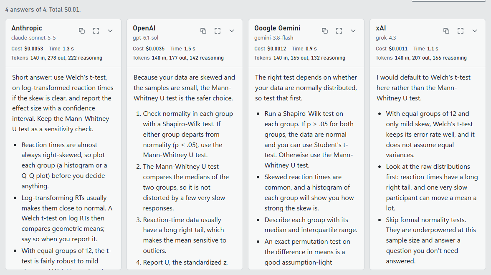
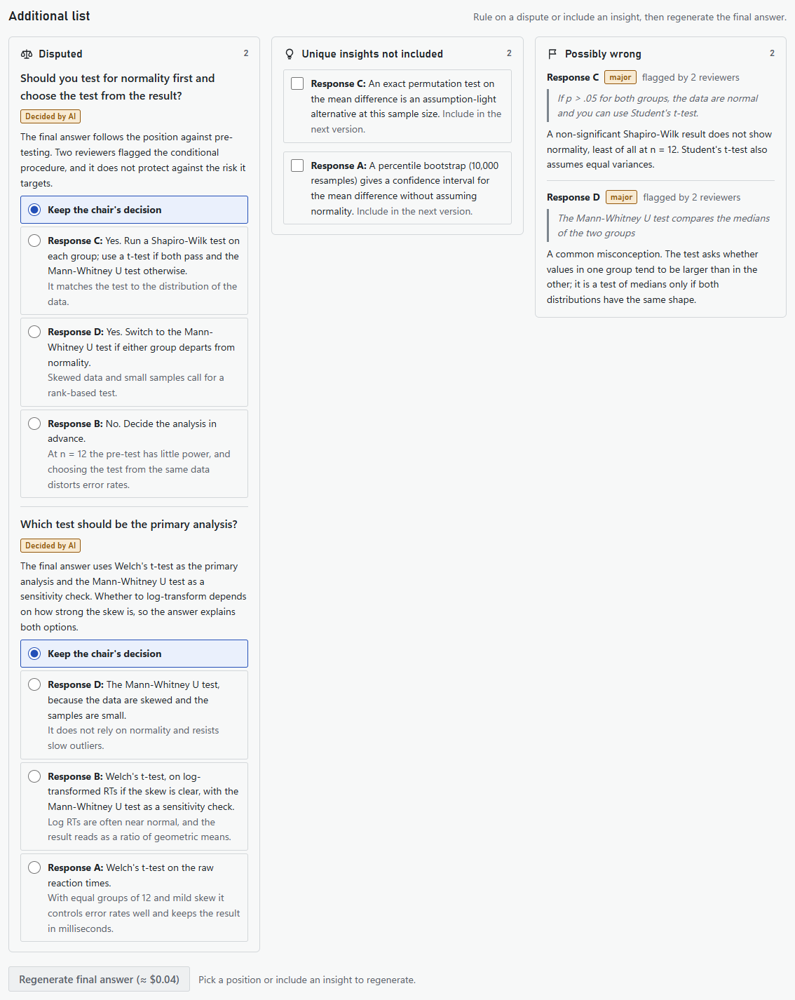
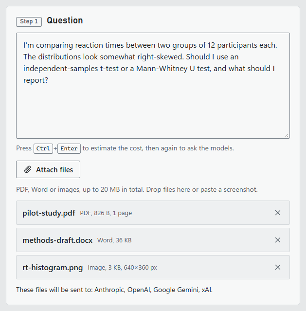
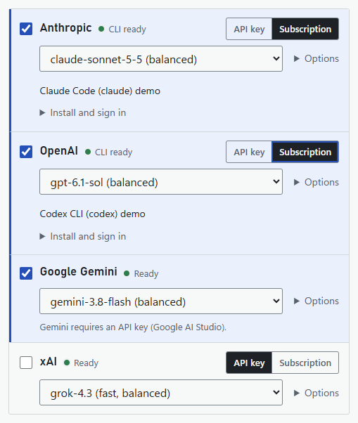
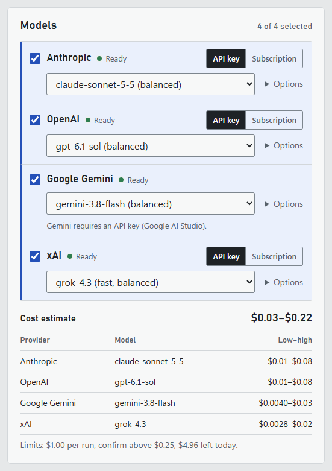
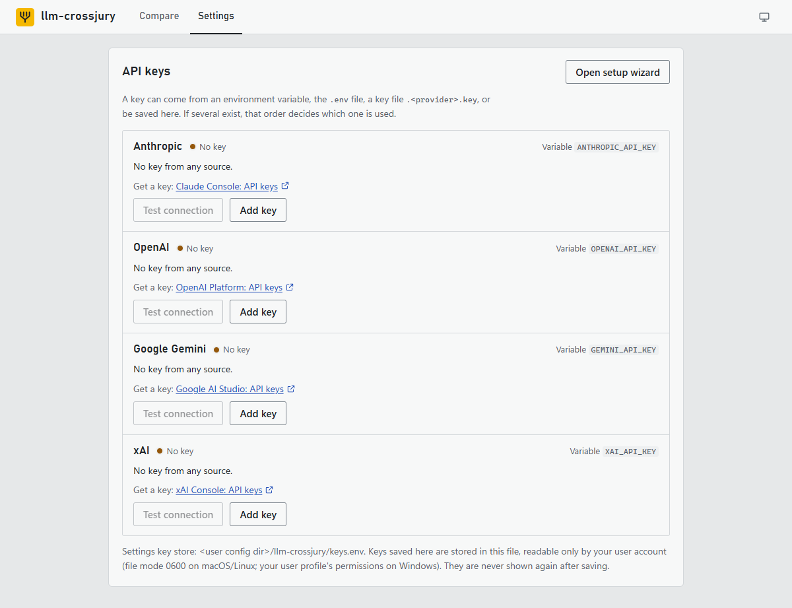
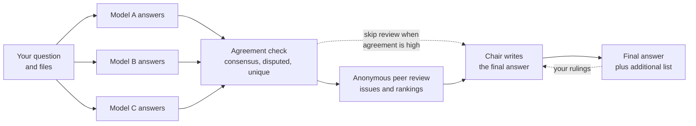

<p align="center">
  
</p>

<p align="center">
  Ask several AI models the same question, compare their answers side by side, and get
  one final answer with the disagreements laid out.
</p>

<p align="center">
  <a href="https://github.com/andyl929/llm-crossjury/actions/workflows/ci.yml"></a>
  <a href="LICENSE"></a>
  
</p>

<p align="center">
  
</p>

llm-crossjury is a local app for students, researchers and anyone who wants a second,
third and fourth opinion. It sends your question (and any PDFs, Word files or
screenshots) to models from Anthropic, OpenAI, Google and xAI, shows every answer, and
can then have the models review each other anonymously before one of them writes the
final answer. Where they still disagree, it tells you, and you decide.

It runs on your machine, uses your own API keys or your existing Claude or ChatGPT
subscription, and shows the cost before every run.

## Why llm-crossjury

| The problem | What llm-crossjury does |
|---|---|
| **One model can be confidently wrong.** A single answer gives you no way to tell a solid claim from a hallucination. | Several models answer independently. The agreement check shows what they all say, where they contradict each other, and what only one of them raised. Peer reviewers flag claims that look wrong, quoting the exact passage. |
| **Comparing tabs by hand is slow.** Copying a question into four chat windows and reading the answers side by side takes time, and the comparison stays in your head. | One question, one click: answers appear in columns, and **AI synthesize** turns them into one answer plus a short list of what it left out and why. |
| **You don't know what it will cost.** API pricing is per token, and multi-model runs multiply it. | Every run is estimated from the published prices before it starts. Built-in limits stop a run that could go over budget. Subscription runs are labelled as plan usage, since their cost per call is unknown. |

## Features

<table>
<tr>
<td width="50%" valign="top">

### Compare answers side by side

Pick the models, estimate the cost, run (Ctrl+Enter works too). Each answer shows its
model, token counts, cost and time; copy one answer or export the whole run as
Markdown.

<picture>
  <source media="(prefers-color-scheme: dark)" srcset="docs/assets/compare-dark.png">
  
</picture>

</td>
<td width="50%" valign="top">

### AI synthesis with an additional list

One click measures agreement, runs one round of anonymous peer review and has a chair
model write the final answer. Below it, the additional list shows disputed points
(marked "decided by AI"), unique insights the chair left out, and claims reviewers
flagged as possibly wrong. Pick a different position or include an insight, then
regenerate.

<picture>
  <source media="(prefers-color-scheme: dark)" srcset="docs/assets/additional-list-dark.png">
  
</picture>

</td>
</tr>
<tr>
<td valign="top">

### Attach PDFs, Word files and screenshots

Drop files on the task, pick them, or paste a screenshot. Models that read PDFs and
images natively get the original file; the others get the extracted text. Before the
run, the app lists every vendor that will receive the files.

<picture>
  <source media="(prefers-color-scheme: dark)" srcset="docs/assets/attachments-dark.png">
  
</picture>

</td>
<td valign="top">

### Use your subscription

Switch a model card from **API key** to **Subscription** to run it through the
official CLI you already signed in to: Claude Code, Codex CLI or Grok Build
(experimental). Gemini works with an API key only.

<picture>
  <source media="(prefers-color-scheme: dark)" srcset="docs/assets/subscription-dark.png">
  
</picture>

</td>
</tr>
<tr>
<td valign="top">

### Cost control

The estimate shows a low to high range per model, using the prices in
[`config/models.yaml`](config/models.yaml). Built-in limits: $1.00 per run, $5.00 per
day, and a confirmation above $0.25. A model without a verified price is refused.

<picture>
  <source media="(prefers-color-scheme: dark)" srcset="docs/assets/estimate-dark.png">
  
</picture>

</td>
<td valign="top">

### Private by design

Keys and files stay on your computer. Each vendor receives only the prompts sent to
its own models. No account, no telemetry. Add or test keys on the Settings page; a
saved key is never shown again.

<picture>
  <source media="(prefers-color-scheme: dark)" srcset="docs/assets/settings-dark.png">
  
</picture>

</td>
</tr>
</table>

The screenshots and the animation come from demo mode (`llm-crossjury ui --demo`), so
the models, token counts and costs in them are simulated. They are regenerated with
[`scripts/capture_readme_media.py`](scripts/capture_readme_media.py).

## Quick start

You need [uv](https://docs.astral.sh/uv/) and Git. uv installs a suitable Python for
you.

```bash
git clone https://github.com/andyl929/llm-crossjury.git
cd llm-crossjury
uv sync
uv run llm-crossjury ui
```

The UI opens at <http://127.0.0.1:8765/>. Use `--port` to pick another port and
`--no-browser` to skip opening a browser tab.

**Try it without keys:** `uv run llm-crossjury ui --demo` starts the same UI with
simulated models and canned answers. It makes no network calls, costs nothing, and
keeps all its state in a temporary folder.

### Add API keys

Open **Settings** in the top bar, paste a key and click **Test connection**. Each card
links to the vendor's key page. Keys saved there go to a file in your user config
folder that only your account can read.

You can also provide keys as environment variables, in a `.env` file in the project
folder, or as one-line key files (`.anthropic.key`, `.openai.key`, `.gemini.key`,
`.xai.key`). The variables are `ANTHROPIC_API_KEY`, `OPENAI_API_KEY`,
`GEMINI_API_KEY` and `XAI_API_KEY`.

### Use a subscription instead

1. Install the vendor's official CLI and sign in yourself, once, in a terminal:
   - **Claude Code:** `curl -fsSL https://claude.ai/install.sh | bash` (macOS, Linux,
     WSL), `irm https://claude.ai/install.ps1 | iex` (Windows PowerShell) or
     `winget install Anthropic.ClaudeCode`. Then run `claude` and sign in with your
     Claude account.
   - **Codex CLI:** `npm install -g @openai/codex`, then `codex login` and choose
     *Sign in with ChatGPT*.
   - **Grok Build (experimental):** `curl -fsSL https://x.ai/cli/install.sh | bash` or
     `irm https://x.ai/cli/install.ps1 | iex`, then run `grok` and sign in.
2. In the UI, switch the model card to **Subscription**. If the CLI is not found yet,
   open *Install and sign in* and click **Re-check**.
3. Tick the consent box before running. Subscription calls count against your plan's
   usage limits, and their cost per call is unknown.

llm-crossjury runs the CLI with tools, file access and command execution turned off,
in an empty temporary folder, and never reads the CLI's login files. See
[ADR 0002](docs/adr/0002-cli-backend-security-boundary.md).

**Coming next:** a PyPI package (`uvx llm-crossjury ui`) and one-click desktop builds
for Windows and macOS. See the [roadmap](docs/ROADMAP.md) (milestones M1 and M2).

## How it works



1. **Answer.** Each selected model answers on its own, without seeing the others.
2. **Agreement.** The answers are split into paragraphs and list items, and one
   inexpensive judge model groups them by meaning. The app then sorts the groups into
   consensus (two or more answers, no contradiction), disputed and unique points, and
   computes the agreement ratio. When at least 80% of the points are shared by every
   answer, it offers to skip the review.
3. **Review.** One round of peer review. Answers are labelled "Response A", "Response
   B" and so on in shuffled order, and model and vendor names are removed from the text.
   Each reviewer sees other answers only, quotes the passage behind every issue, rates
   its severity, and ranks the answers. The app combines the rankings with a Borda
   count.
4. **Chair.** One model writes the final answer from the answers, the agreement
   groups and the reviews. It records each dispute with its provisional decision, and
   the insights it chose to leave out. You can overrule any decision and regenerate.

**Why it is built this way.** Language models used as judges have documented biases:
they can favor an answer because of its position and favor their own answers (Zheng
et al., *Judging LLM-as-a-Judge with MT-Bench and Chatbot Arena*, 2023), and they can
recognize and prefer their own generations (Panickssery et al., *LLM Evaluators
Recognize and Favor Their Own Generations*, 2024). llm-crossjury therefore hides who
wrote what, shuffles the labels on every run, and never lets a model review its own
answer. Reviewers rank answers and back each issue with a quote instead of giving 1 to
10 scores, since comparative judgments have been found to match human judgment better
than direct scores (Liu et al., *Aligning with Human Judgement: The Role of Pairwise
Preference in Large Language Model Evaluators*, 2024). Review runs once, which keeps
cost predictable; disagreements that remain go to you instead of another round.

## Privacy and cost

**What leaves your computer.** Your question and attachments go to the vendors whose
models you select. During synthesis, the anonymized answers and reviews go to the
judge, reviewer and chair models you chose, and the attachments to the chair only. API
calls go straight to the vendor with your key. Subscription calls go through the
vendor's own CLI with its own login. Nothing is sent to the llm-crossjury project or
any third party, and there is no telemetry.

**What stays on your computer.**

- **Keys** stay on your machine and go only to their own vendor. The app never prints
  or logs them, and the UI only says whether a key is set.
- **Attachments** are kept in your user data folder and deleted 24 hours after upload.
  No vendor file storage is used: files travel inside the request.
- **Spending records** (a local SQLite ledger) hold token counts, costs and durations,
  never prompt or answer text.

**Budget defaults.** $1.00 per run, $5.00 per calendar day, and a confirmation prompt
for any run estimated above $0.25. The budget line at the top of the UI shows today's
spend. Prices come only from [`config/models.yaml`](config/models.yaml), where every
entry links to the vendor's pricing page and records the date it was checked.

## Supported models

From [`config/models.yaml`](config/models.yaml), checked against the vendors' pages on
2026-11-08. The aliases in brackets (`fast`, `balanced`, `best`) pick the default
model per card and the inexpensive judge and reviewer models. Regenerate this table
with `uv run python scripts/readme_models_table.py`.

<!-- models-table:start -->
| Vendor | With an API key | With a subscription |
|---|---|---|
| Anthropic | `claude-haiku-5-5` (fast), `claude-sonnet-5-5` (balanced), `claude-opus-5-5`, `claude-fable-5-1` (best) | Claude Code (`claude`): `claude-haiku-5-5`, `claude-sonnet-5-5`, `claude-opus-5-5`, `claude-fable-5-1` |
| OpenAI | `gpt-6-luna` (fast), `gpt-6.1-sol` (balanced), `gpt-6-astra` (best) | Codex CLI (`codex`): `gpt-6-luna`, `gpt-6.1-sol`, `gpt-6-astra` |
| Google Gemini | `gemini-3.5-flash-lite` (fast), `gemini-3.8-flash` (balanced), `gemini-4-argon` (best) | not offered (API key only) |
| xAI | `grok-4.3` (fast, balanced), `grok-4.7` (best) | Grok Build (`grok`), experimental: `grok-4.7`, `grok-4.7-build-fast` |
<!-- models-table:end -->

Vendors change models and prices often. To use a model that is not listed, add an
entry to `config/models.local.yaml` (it overrides the shipped file and is ignored by
Git) with its official source link and the date you checked it.

## FAQ

**Why can't Gemini use my subscription?**
Google stopped serving Google AI Pro, Ultra and free accounts through Gemini CLI on
2026-06-18 ([gemini-cli discussion 27274](https://github.com/google-gemini/gemini-cli/discussions/27274)),
and its replacement states that wrapping it in third-party applications is not
supported under consumer plans ([Antigravity FAQ](https://antigravity.google/docs/faq/)).
Gemini therefore needs an API key from Google AI Studio.

**Is subscription mode allowed?**
llm-crossjury only launches the vendor's own, unmodified CLI, signed in by you, and
never touches its credentials. Anthropic's terms allow an end user to sign in to the
unmodified Claude Code binary with their own subscription
([Claude Code legal and compliance](https://code.claude.com/docs/en/legal-and-compliance)).
OpenAI documents non-interactive use of Codex with the saved CLI login
([Codex non-interactive mode](https://learn.chatgpt.com/docs/non-interactive-mode)).
We have not yet verified xAI's terms for Grok Build, so it stays labelled
experimental. Check your own plan's terms; our reasoning is in
[ADR 0002](docs/adr/0002-cli-backend-security-boundary.md).

**How much does a run cost?**
It depends on the models, the length of your question and answers, and any
attachments. The estimate before each run shows the range, and the results show what
each call actually cost. Answers are usually the smaller part; the synthesis reads
every answer again, so it costs more. Choosing the *Economy* review tier uses each
vendor's `fast` model for the reviews.

**Does it remember my questions?**
No. Answers live only in your browser tab. The ledger records costs, not text. Run
history is on the roadmap.

**Can I run it from the command line?**
Only the UI works today (`llm-crossjury ui`). The `run`, `cost` and `models` commands
are placeholders for now.

## Roadmap

See [docs/ROADMAP.md](docs/ROADMAP.md). Next up: the PyPI package, local run history, a desktop app for Windows and macOS, a redesigned UI
with streaming answers, and the command-line `run` command with the Council and
Document Review modes described in the [spec](docs/SPEC.md).

## Contributing

Issues and pull requests are welcome. Read [AGENTS.md](AGENTS.md) first: it holds the
working rules (no hard-coded model facts or prices, no credential handling, tests for
every change). Design documents and decision records live in [docs/](docs/).

```bash
uv sync
uv run pytest
uv run ruff check . && uv run ruff format --check .
uv run mypy
```

This is a clean-room implementation: no code from other "LLM council" projects was
viewed or used ([ADR 0005](docs/adr/0005-clean-room-and-license.md)).

## License

[MIT](LICENSE)
